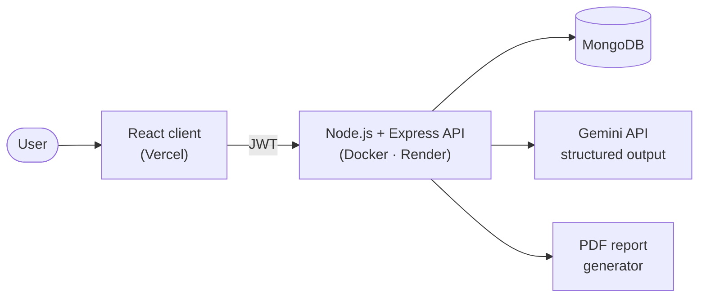

# Het Shah

**Full Stack Developer** · Greater Toronto Area (GTA), Canada
I build the APIs behind the interface.

[](https://www.linkedin.com/in/hetshah2406)
[](https://het-shah-portfolio.vercel.app/)
[](mailto:hetshah1324@gmail.com)

```http
HTTP/1.1 200 OK
Host:        github.com/HetShah24-06
Role:        Full Stack Developer (Node.js · React · TypeScript)
Experience:  3+ years
Status:      🟢 Open to full-stack and backend roles
```

---

## 📑 Endpoints

| Method | Endpoint | Returns |
| :-- | :-- | :-- |
| `GET` | [`/about`](#get-about) | Who I am and what I'm learning |
| `GET` | [`/experience`](#get-experience) | Where I've worked and what I shipped |
| `GET` | [`/projects`](#get-projects) | Selected work, with architecture |
| `GET` | [`/stack`](#get-stack) | Tools, grouped by layer |
| `GET` | [`/education`](#get-education) | Degrees and certifications |
| `POST` | [`/contact`](#post-contact) | How to reach me |

---

## `GET /about`

```json
{
  "name": "Het Shah",
  "role": "Full Stack Developer",
  "focus": "Backend-first: REST APIs, data modelling, auth, and the UI that calls them",
  "currently": "Full Stack Developer, Consultant @ Void Enterprise Inc.",
  "learning": ["RAG", "AI agents", "LLM-powered apps"],
  "location": "Greater Toronto Area (GTA), Canada",
  "languages": ["English", "Hindi", "Gujarati"],
  "pronouns": "he/him"
}
```

---

## `GET /experience`

**Full Stack Developer, Consultant (Contract)** · Void Enterprise Inc. · Remote, GTA
`Sep 2025 – Present`
- Build full-stack and backend features for client projects with React / Next.js front ends and Node.js APIs.
- Design and maintain MongoDB data layers behind those features.

**Software Engineer Intern** · Void Enterprise Inc.
`Jul 2024 – Feb 2025`
- Built React websites and Node.js APIs end to end.
- Maintained the PostgreSQL database, fixed production bugs, and wrote Jest tests.

**Web Developer Intern** · KashCandi Technology Solutions · Vadodara, India
`Feb 2022 – Jul 2023`
- Built front-end features with HTML, CSS, JavaScript, and React on a MySQL back end.
- Did manual testing and bug fixing; worked in a Git / GitHub team workflow.

**Web Developer Intern** · CODEMASTR APPS · Vadodara, India
`Dec 2021 – Feb 2022`
- First dev role: built web features and learned production workflows.

---

## `GET /projects`

### 🤖 Interview Master &nbsp; `200 OK · live`
AI interview-prep platform. Users practise interviews, get AI feedback as structured LLM output, and download PDF reports.

[Live demo](https://interview-master-ebon.vercel.app/) · [Source](https://github.com/HetShah24-06/ai-interview-prep)



`React` `Node.js` `Express` `MongoDB` `Gemini API` `JWT` `Docker`

### 💳 RewardsX / MerchantX API &nbsp; `403 · confidential`
Capstone with **Credwise Financial Inc.** I led a 3-person team building the MerchantX backend.
- Designed and shipped **8+ REST APIs**, documented in Swagger.
- Built the PostgreSQL schema and transaction-enrichment logic.
- Cut average API response time by **18%**.

`Node.js` `Express` `PostgreSQL` `Swagger` · *Code is private; happy to walk through the design in an interview.*

### 📦 OwnIt &nbsp; `202 Accepted · in progress`
AI inventory assistant that helps avoid duplicate purchases, built with RAG and an agent layer on Gemini.

`RAG` `AI agents` `Gemini API`

### 🎬 Your Own Theater &nbsp; `200 OK · live`
Movie discovery and theatre app: browse, search, and explore films.

[Live demo](https://yourowntheater.onrender.com/) · [Source](https://github.com/HetShah24-06/YourOwnTheater) · `React` `Node.js` `JavaScript`

<details>
<summary><b>More projects</b> (<code>GET /projects?page=2</code>)</summary>
<br />

| Project | What it is | Stack |
| :-- | :-- | :-- |
| Healthcare Appointment System | Desktop booking app | Java · JavaFX · SQLite |
| Cafe Management System | Orders and menu management | C# · .NET |
| MovieExplorer | iOS movie browser | Swift |
| BookYourWay | Android flight booking (team of 4) | Java · Firebase |

[All repositories →](https://github.com/HetShah24-06?tab=repositories)

</details>

---

## `GET /stack`

| Layer | Tools |
| :-- | :-- |
| **Backend** | Node.js · Express · NestJS · REST · JWT · OAuth 2.0 |
| **Frontend** | React · Next.js · TypeScript · JavaScript |
| **Data** | PostgreSQL · MongoDB · MySQL |
| **AI** | Gemini API · structured LLM output · RAG *(learning)* |
| **DevOps & testing** | Docker · GitHub Actions · Jest · Git · AWS |
| **Also worked with** | Java · C# / .NET · Swift |

---

## `GET /education`

| | |
| :-- | :-- |
| **PG Certificate, IT Solutions** · Humber Polytechnic, Toronto | 2024 – 2025 · GPA 3.50/4.00 · Dean's Honours List |
| **BE, Computer Engineering** · SVIT Vasad, Gujarat Technological University | 2019 – 2023 · CGPA 8.0/10 |
| **AWS Certified Cloud Practitioner** | Certification |

---

## `POST /contact`

```http
POST /contact HTTP/1.1
Content-Type: application/json

{
  "to": "hetshah1324@gmail.com",
  "subject": "Let's build something real"
}
```

```http
HTTP/1.1 201 Created
```

Working on something interesting? [Email me](mailto:hetshah1324@gmail.com) or connect on [LinkedIn](https://www.linkedin.com/in/hetshah2406).
